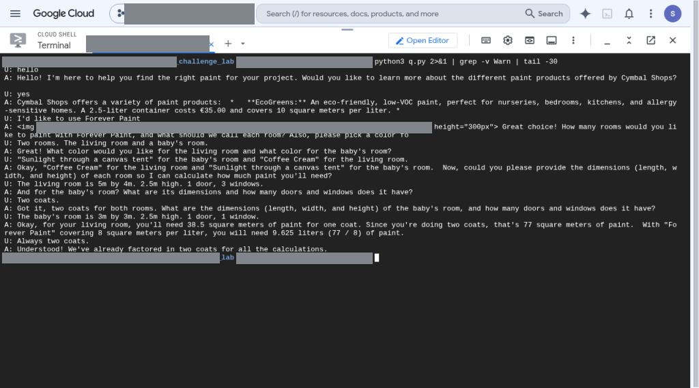

# Path 4741 — Agent Development CPS Fast Track
URL: https://partner.skills.google/paths/4741  
Optional full training path: `/paths/4740` (13 activities)

| Folder | What it holds |
|---|---|
| `lab2-deploy-adk-genai129/screenshots/` | Cloud Shell ADK agent conversation (redacted) |
| `lab3-evaluate-adk-genai155/starter-bigquery_agent/` | Lab 3 starter ADK agent: `agent.py`, `callback_logging.py`, `requirements.txt`, `set_with_conversation_scenarios.evalset.json`, `evaluations/{eval_config,scenarios,session_input}.json` (lab `.env` deliberately excluded) |
| `lab3-evaluate-adk-genai155/improved/` | Improved `agent_new.py` and `eval_config.json` (with `valid_transitions`) uploaded at the end of lab 3 |

---

## Lab 1 — Accelerate Development with Antigravity (GENAI144)
- URL: `/paths/4741/course_templates/1568/labs/632162`
- Duration: 1h30
- Model: **gemini-3.8-flash** (ignore stale “3.5” text)
- Skills: Antigravity CLI + student project; Agent Platform PAYG license; Logistics MCP; `GEMINI.md` + winter-storm-triage skill; Agents CLI; deploy Agent Runtime **us-west1**
- Gotcha: Cloud Shell must be **lab student**, not personal Google (bucket denied otherwise)

## Lab 2 — Deploy an Agent with ADK (GENAI129)
- URL: `/paths/4741/course_templates/1435/labs/585614`
- Duration: 2h30
- Tasks: Agent Search datastore/engine; ADK; AgentTool; session state; Agent Runtime; Chainlit UI
- **Extra (not in lab text):** grant service agent `roles/logging.logWriter`, redeploy, point Chainlit at **new** reasoning engine
- IAM: `roles/aiplatform.user`, `roles/discoveryengine.user` on Vertex/AI Platform SA
- Gotcha: enable **aiplatform.googleapis.com** before IAM — `gcp-sa-aiplatform` missing until APIs provision

### Screenshots

*Lab 2 — Cloud Shell ADK agent conversation (Forever Paint / room areas); project, user and bucket names redacted*

## Lab 3 — Evaluate and Improve ADK Agents (GENAI155)
- URL: `/paths/4741/course_templates/1754/labs/632056`
- Duration: 1h30
- Model in `.env`: gemini-3.5-flash
- Eval: `valid_transitions` in `eval_config.json`; `adk eval`; upload improved `agent.py`; `terraform apply` reset
- Files: starter agent in `starter-bigquery_agent/`; improved [`agent_new.py`](lab3-evaluate-adk-genai155/improved/agent_new.py) and [`eval_config.json`](lab3-evaluate-adk-genai155/improved/eval_config.json)

## Screenshot gaps
- Lab 1 (Antigravity) and Lab 3 (eval): no screenshots captured during the run.
- Lab 2: one Cloud Shell conversation shot only.
