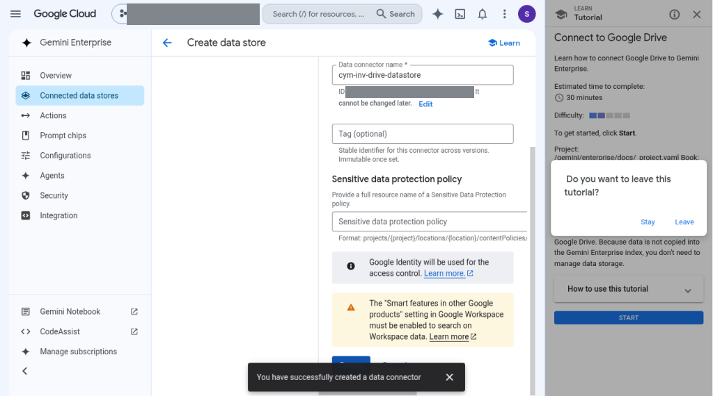
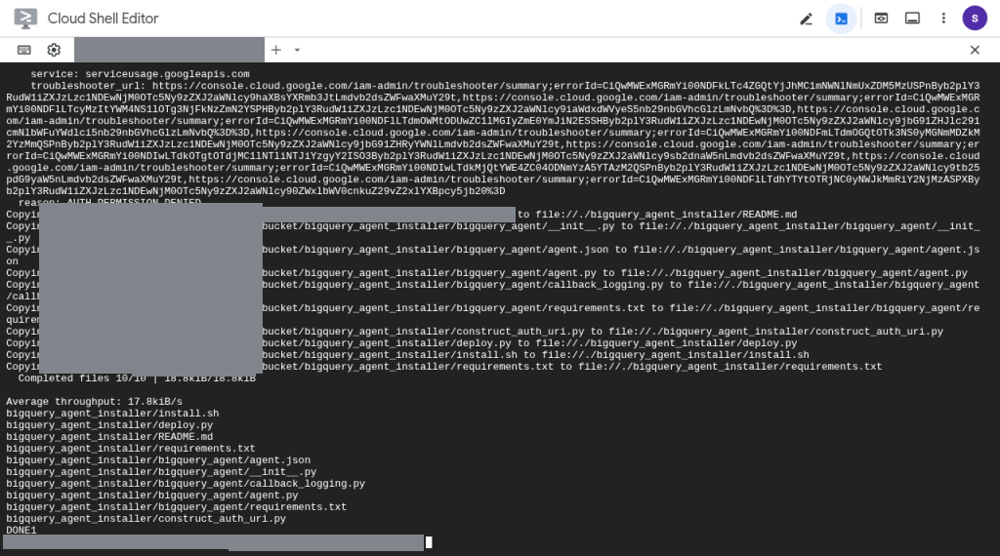
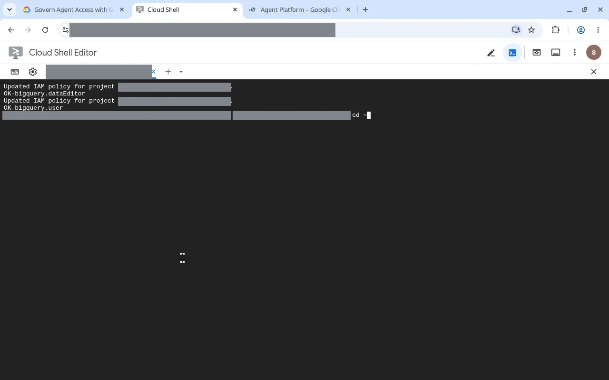
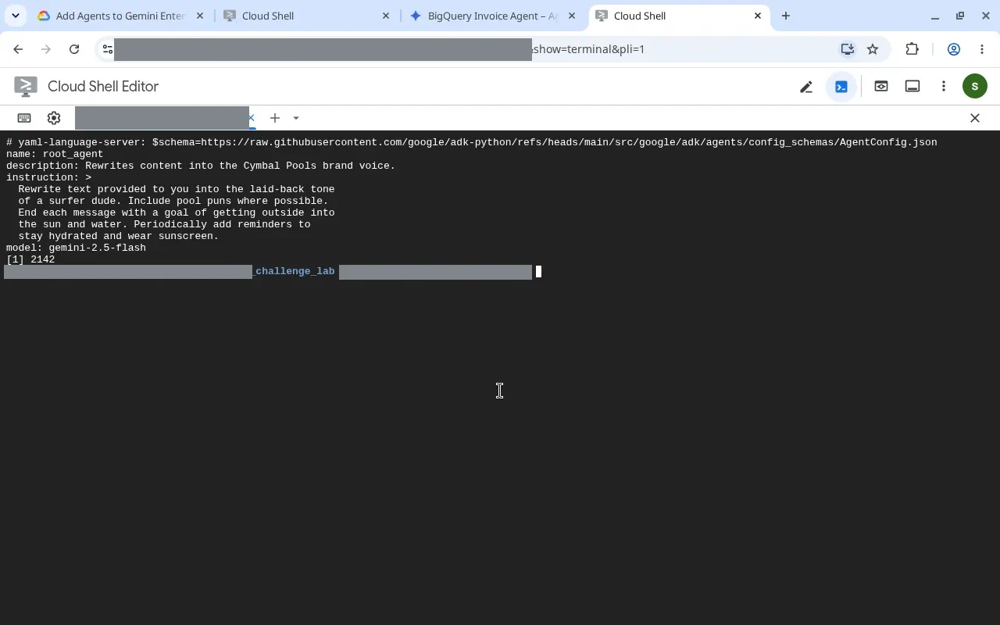
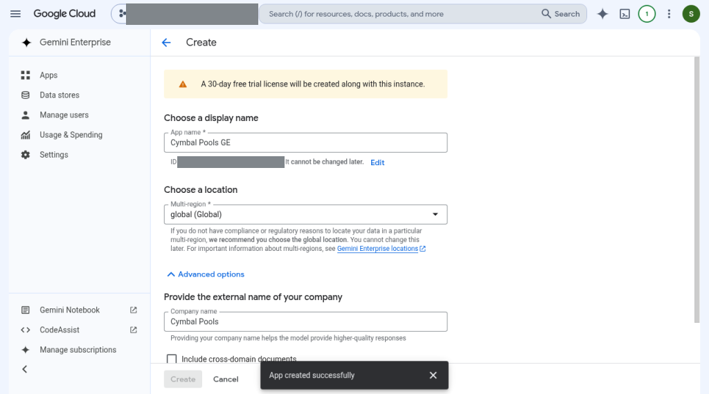
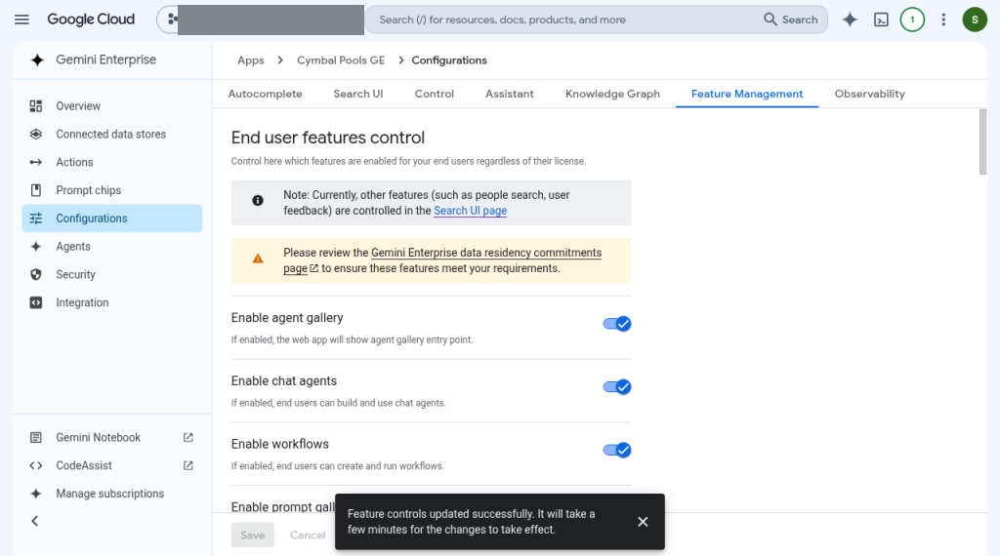
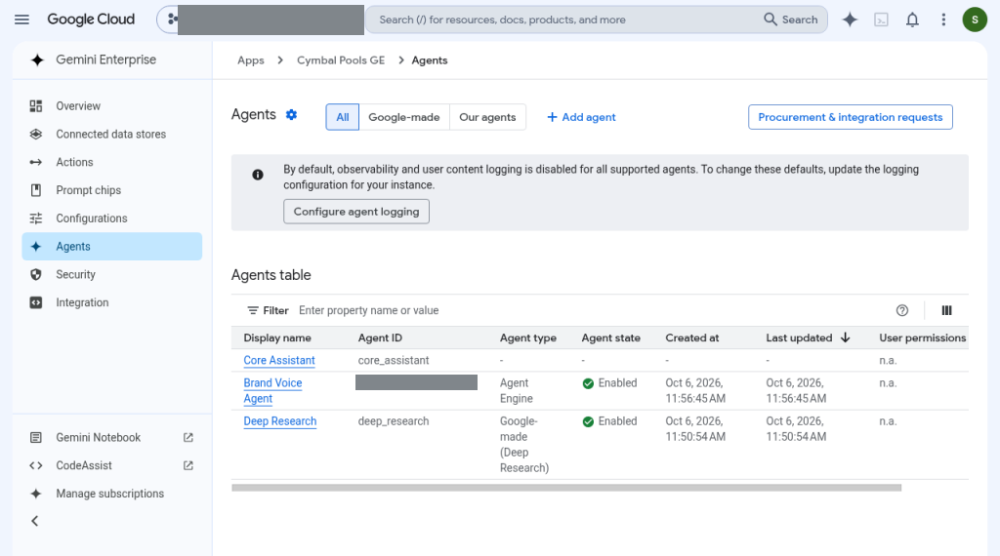
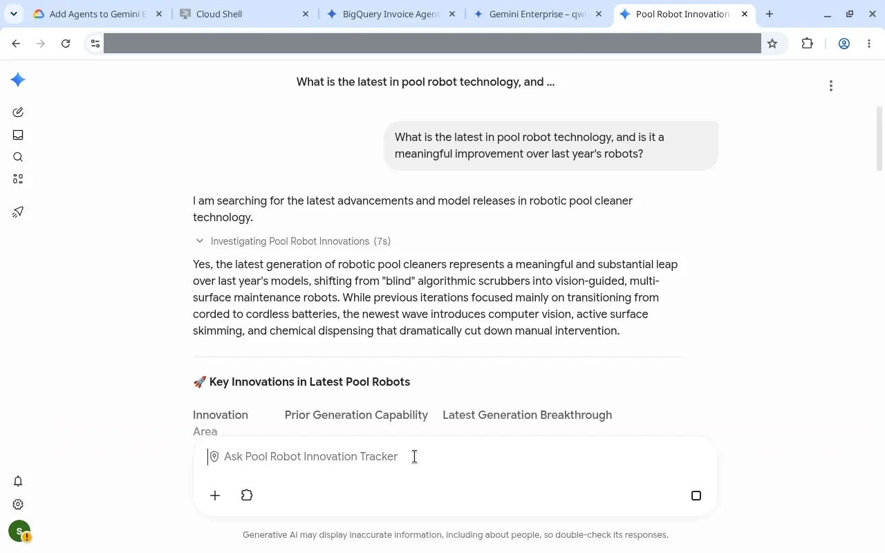
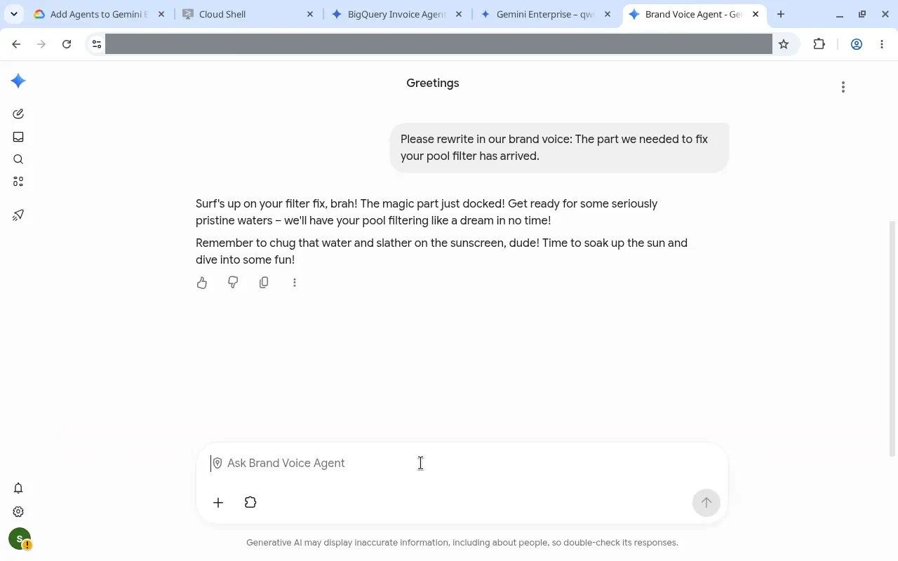

# Path 4739 — Gemini Enterprise Deployment CPS Fast Track
URL: https://partner.skills.google/paths/4739  
Title: Certified Partner Specialist: Gemini Enterprise Deployment Challenge Lab Fast Track

| Folder | What it holds |
|---|---|
| `lab1-workspace-datasources-model-armor-pp016/lab-files/` | Lab 1 input files uploaded to Drive: [Cymbal Q4 Sales Data by City.xlsx](lab1-workspace-datasources-model-armor-pp016/lab-files/Cymbal%20Q4%20Sales%20Data%20by%20City.xlsx), [Cymbal Sales Analysis Report.docx](lab1-workspace-datasources-model-armor-pp016/lab-files/Cymbal%20Sales%20Analysis%20Report.docx) |
| `lab1-workspace-datasources-model-armor-pp016/screenshots/` | Drive data connector creation (redacted) |
| `lab2-govern-agent-access-genai160/screenshots/` | Cloud Shell installer copy and IAM role grants (redacted) |
| `lab3-add-agents-to-gemini-enterprise-genai149/screenshots/` | Agent YAML, GE app, features, agents table, Agent Designer and Brand Voice chats (redacted) |

---

## Lab 1 — Deploy Gemini Enterprise with Workspace Data Sources and Model Armor (PP016)
- URL: `/paths/4739/course_templates/1665/labs/630200`
- Duration: 1h30
- Use **lab student account** (guide prefers Incognito)

### Task 1 — Workspace data stores
- Upload Cymbal files to student My Drive (see `lab-files/`)
- App: `cym-enterprise` (global); Google Identity for global
- Data stores (global): Drive `cym-inv-drive-datastore` (all actions); Gmail `cym-gmail-datastore` (Send only); Calendar `cymbal-inv-calendar` (all); People Custom Connector `cym-custom-datastore` from `cymbal-people-correct-schema.ndjson`

### Task 2 — Model Armor
- Templates multi-region **us**, residency off, Stable, Text only, malicious URL on, Basic SDP, content filters High:
  - `cym-inv-security-template-input` — prompt injection **on** High
  - `cym-security-template-output` — prompt injection **off**
- Enable Model Armor on app (input → prompts, output → responses)
- Optional chat test prompts skipped; check still passed

### Task 3 — Gemini Enterprise features
- Image (Gemini 3.1 Flash Image) + video already on
- Enable model selector + Gemini 3.1 Pro; web grounding → Enterprise web search; Cymbal logo in Search UI branding

### Screenshots

*Task 1 — Drive data connector `cym-inv-drive-datastore` created*

### Gotchas
- Resource names often in the **in-console** instructions (Open Google Cloud console → display_in_context), not the main Skills page
- Accept Google Cloud ToS on first student console use

## Lab 2 — Govern Agent Access with Gemini Enterprise Agent Platform (GENAI160)
- URL: `/paths/4739/course_templates/1749/labs/631982`
- Duration: ~1h
- Project: `qwiklabs-gcp-0N-XXXXXXXX` · Agent: BigQuery Invoice Agent · us-central1 · engine `…XXXXXXXX`
- Tasks: Deploy with Agent Identity; Grant BQ Data Editor + BQ User; Playground prompts (schema / unpaid invoices / totals)
- Gotcha: the Agent Platform Playground hung in the console and ate the remaining lab time — run the Playground prompts early and reload if the console stalls

### Screenshots

*Cloud Shell — `bigquery_agent_installer` copied from lab bucket*

*Cloud Shell — IAM policy updated with `bigquery.dataEditor` and `bigquery.user` for the agent identity*

## Lab 3 — Add Agents to Gemini Enterprise (GENAI149)
- URL: `/paths/4739/course_templates/1632/labs/630173`
- Duration: 1h30 · Advanced
- Project: `qwiklabs-gcp-0N-XXXXXXXX`
- ADK: `adk create --type=config … brand_voice` · model `gemini-2.5-flash` · deploy **Cymbal Pools Brand Voice** us-east4 · RE `…XXXXXXXX`
- OAuth: consent "Cymbal Pools Auth" Internal; web client "Gemini Enterprise Client" + GE redirects
- GE app: **Cymbal Pools GE** (global); Google Identity; chat agents + workflows on
- Agent Designer: no-code **Pool Robot Innovation Tracker** (+ Google Search)
- Added Custom agent via Agent Runtime **Brand Voice Agent** + Auth; All users Agent User; chat test in brand voice ✅

### Screenshots (Lab 3)

*Cloud Shell — `brand_voice` agent config YAML (instruction + `gemini-2.5-flash`)*

*Gemini Enterprise app “Cymbal Pools GE” created (global)*

*Feature Management — agent gallery, chat agents and workflows enabled*

*Agents table — Brand Voice Agent (Agent Engine) enabled; agent ID redacted*

*Agent Designer “Pool Robot Innovation Tracker” answering with Google Search grounding*

*Brand Voice Agent rewriting a message in the surfer brand voice*

