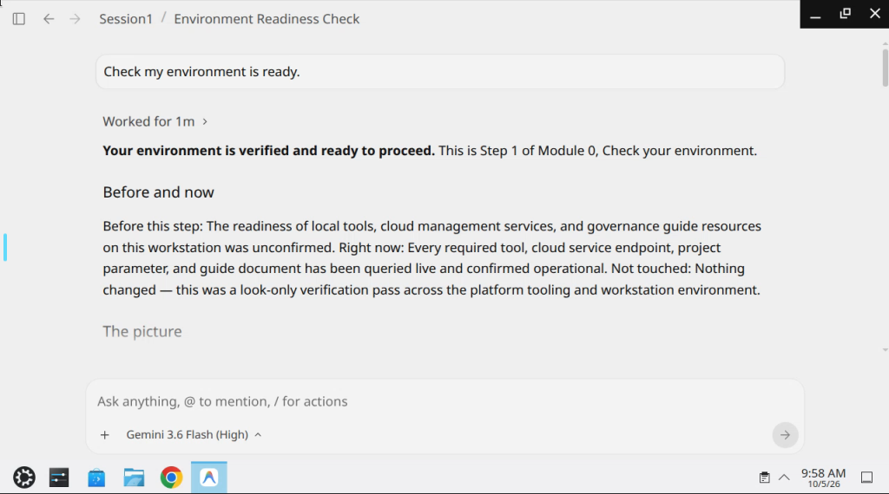
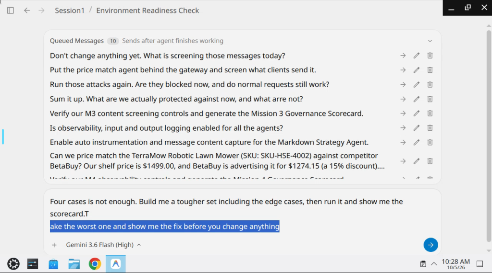

# Workshop Track 2 — Platform Builder (NovaSmart)
Lab: Build with Gemini GSI – All Tracks (Qwiklabs)  
Guide: https://storage.googleapis.com/bwg-track2-fsi-demo-guide/lab_instructions.html  
Session: ~4 hours per Start Lab

| Folder | What it holds |
|---|---|
| `novasmart-guide-capture/` | [novasmart-control-center.html](novasmart-guide-capture/novasmart-control-center.html) — saved copy of the NovaSmart Control Center course guide (generic; no learner data); [mission-steps.txt](novasmart-guide-capture/mission-steps.txt) — the guide's per-mission step definitions (prompts, checks, explanations) as text |
| `screenshots/` | Remote Ubuntu agent session: environment readiness and queued mission prompts |

## How the missions are checked
- Scorecard lives inside the remote Ubuntu desktop: `localhost:8088/governance_scorecard.html` (not on the Qwiklabs page)
- M2 Perimeter is **locked** in Track 2, so it can't be attempted there
- Badges shown in the HTML guide are cosmetic, not scored checks

## Missions
| Mission | Theme | Notes |
|---|---|---|
| M0 | Environment readiness | Prep; no scorecard row |
| M1 | Identity & Data Least Privilege | Governance scorecard check |
| M2 | Inbound/Outbound Perimeter | Locked in Track 2 — skip |
| M3 | Ingress Model Armor Screening | Governance scorecard check |
| M4 | Distributed Tracing & Observability | Governance scorecard check |
| M5 | Eval / improve (prompt steps) | Steps 1–4 checked via the agent; no scorecard row |

## Themes / gotchas
- Shadow Cloud Run `promo-agent-shadow`; shared SA blast radius → per-agent SAs / least privilege
- Prefer official NovaSmart guide prompts word-for-word
- Remote desktop can freeze — reload; type prompts slowly

## Screenshots

*Remote Ubuntu session — M0 environment readiness verified by the agent*

*Remote session queued prompts — M3 screening, observability and M5 eval steps*
