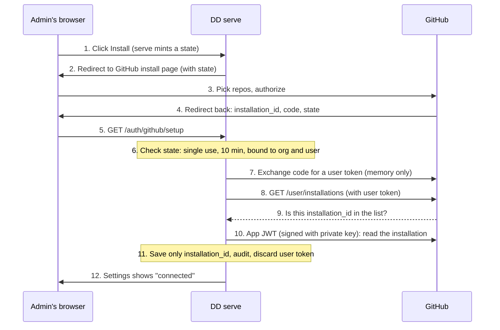

# GitHub App vs OAuth App: the Connect GitHub auth flow

Study note from a Defect Drainer (DD) session, 2026-11-18. Verified against real GitHub in acceptance test AC17: install, clone with a read token, push with a write token, PR opened, no token stored at rest.

## The flow

## Knowledge points

1. **Two kinds of GitHub integration**

   | | OAuth App | GitHub App |
   |---|---|---|
   | Acts as | The signed-in user | Itself (its own identity) |
   | Token | User token `gho_…` | Installation token `ghs_…`, valid 1 hour |
   | Scope | The user's whole scope; can't be narrowed per repo | Only the repos and permissions the owner picked at install |
   | Lifetime | Until the user revokes it | Minted on demand from a JWT |
   | Used by | Deploybot (pulling images from ghcr) | DD |

2. **Why DD needs a private key and Deploybot doesn't.** When a job runs, no human is signed in, so the app has to prove it is itself. It does this with a JWT signed RS256 by its `.pem` private key, which it exchanges for an installation token. An OAuth App only needs its client secret (or PKCE) for the one-time sign-in exchange.
3. **The `state` parameter (steps 1, 2 and 6) prevents CSRF.** The callback must answer an install that the admin actually started. Store only a hash of it, use it once, and make it expire.
4. **Verify who installed the app (steps 7–9).** The `installation_id` in the callback URL can be forged. Turn on "Request user authorization (OAuth) during installation", exchange the code for a user token, and confirm that `GET /user/installations` lists that id. Otherwise anyone could claim another org's installation and get tokens for its repos.
5. **Store the minimum.** Keep only `installation_id` and discard the user token. The App's private key and client secret stay in the server's environment (a secret store), never in the database.
6. **Mint a token per job.** For each job the server mints a token for one repo: a read token (clone/fetch), or a write token (push) only while a ship is pending.
   - The worker keeps the token in memory only.
   - It hands it to git through `GIT_CONFIG_COUNT` environment variables, as an `http.<origin>.extraheader` Basic auth header. The token never appears on the command line, in `.git/config` or in logs.
   - The server, not the worker, opens the PR through the API.
7. **Gotcha: "Configure → Save" sends no code.** If the App is already installed and you only press Configure → Save, GitHub returns no OAuth code, so the installer can't be verified. Uninstall the App and install it again.
8. **Gotcha: a space after `=` in an env file.** `APP_ID= 123` makes the shell set the variable to empty.

## Why Deploybot doesn't use a GitHub App (yet)

- A GitHub App installation token can't pull ghcr packages outside GitHub Actions. So Deploybot uses an OAuth App user token with `read:packages`.
- The trade-off is that this token is broad (it acts as the user) and can be revoked without warning. Deploybot's GitHub connection showed `login_failed` on 2026-11-17.
- The mitigations are a minimal scope, the token sealed with AES-GCM at rest and delivered per task, and never written to disk on hosts.

## Refresh questions

1. Which token prefix belongs to which app type, and how long does an installation token last?
2. Why can't DD trust the `installation_id` in the callback URL, and which three steps close that gap?
3. What three properties must the `state` value have?
4. After a successful install, what does DD store, and what does it discard?
5. How does the worker give git a token without putting it on the command line or in `.git/config`?
6. You reinstall a GitHub App but the callback has no `code`. What happened, and how do you fix it?
7. Why does Deploybot use an OAuth App for ghcr, and what risks does that bring?

## Sources

- The DD repo's `docs/github-app.md` and `docs/contracts/worker-protocol-v1.md` §14
- GitHub docs: [About creating GitHub Apps](https://docs.github.com/en/apps/creating-github-apps/about-creating-github-apps/about-creating-github-apps) · [Differences between GitHub Apps and OAuth Apps](https://docs.github.com/en/apps/oauth-apps/building-oauth-apps/differences-between-github-apps-and-oauth-apps)
